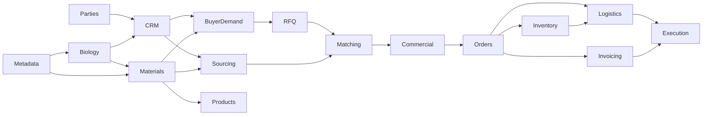

# Arb-Int.Domain

`Arb-Int.Domain` innehåller Arb-Ints gemensamma domänmodell och Entity Framework Core-konfigurationer.

Projektet används av bland annat:

* `Arb-Int.API`
* `Arb-Int.WorkerService`
* `Arb-Int.DataMigration`

Domänprojektet ska beskriva **vad informationen betyder och hur affärsobjekten hänger ihop**, inte hur API, bakgrundsjobb eller importer exekveras.

---

# Övergripande modell

Arb-Int bygger på några viktiga separationer:

```text
Identitet
    ↓
Affärsrelation
    ↓
Kunskap / claims / demand
    ↓
Supplier offerings / buyer RFQ
    ↓
Material
    ↓
Matchning och SupplySolution
    ↓
Offert / Proposal
    ↓
Sales order + Purchase orders
    ↓
Inventory-Lots / kvalitet / logistik
    ↓
Fakturering och execution
```

En grundprincip är att skilja på:

1. **Vem någon är**
2. **Vilken affärsrelation vi har med dem**
3. **Vad vi tror eller vet om dem**
4. **Vad de faktiskt erbjuder eller efterfrågar**
5. **Vad materialet objektivt är**
6. **Hur efterfrågan kan matchas mot utbud**
7. **Vilka kommersiella transaktioner som faktiskt genomförs**

Det gör att information kan vara ofullständig eller osäker utan att vi behöver skapa falskt exakta modeller.

---

# Huvudområden



---

# 1. Parties – vem parten är

`Party` är roten för personer och organisationer.

```text
Party
├── Organization
└── Person
```

En organisation är exempelvis:

* supplier
* buyer
* processor
* laboratorium
* lagerpartner
* speditör
* transportör
* Algaebras eget bolag

Men dessa roller ligger **inte** på `Organization`.

Organisationen beskriver identiteten. Affärsrollen beskrivs av CRM-lagret.

## Viktiga modeller

### `Party`

Gemensam bas för organisationer och personer.

### `Organization`

En juridisk eller organisatorisk part.

### `Person`

En fysisk person.

En `Person` är inte automatiskt en systemanvändare.

På sikt kan personen kopplas till Identity:

```text
Person
    ↓
PersonUserAccount
    ↓
ApplicationUser
```

Det gör att personer kan finnas som kontakter långt innan de får möjlighet att logga in.

### `OrganizationPerson`

Beskriver personens koppling till en organisation.

Här hör exempelvis:

* titel
* avdelning
* giltighetstid

Samma person kan därför förekomma hos flera organisationer över tid.

### `PartyAddress`

Kopplar en part till en normaliserad `Address`.

### `PartyContactPoint`

E-post, telefon, webbplats eller annan kontaktväg.

### `PartyExternalReference`

Identifierar samma part i ett externt system eller en importerad datakälla.

Detta är viktigt för idempotent datamigrering.

---

# 2. CRM – vilken affärsrelation vi har

En organisation är inte i sig en supplier eller buyer.

Det är relationen mellan Algaebra och organisationen som har den rollen.

```text
Owning Organization
        ↓
BusinessRelationship
        ↓
Counterparty
```

Exempel:

```text
Algaebra
    ↓
BusinessRelationship
Type = Supplier
    ↓
Seaweed Company AB
```

Samma organisation kan samtidigt ha:

```text
Supplier
Buyer
Processor
Partner
```

genom olika `BusinessRelationship`.

## `BusinessRelationship`

CRM-roten för en relation mellan:

```text
OwningOrganization
Counterparty
```

Relationen innehåller bland annat:

* relationstyp
* pipeline stage
* prioritet
* ansvarig
* status

## `BusinessRelationshipType`

Exempel:

```text
Supplier
Buyer
Processor
Partner
Laboratory
Warehouse
FreightForwarder
Carrier
```

Typerna beskriver relationen, inte organisationen.

## `BusinessRelationshipStage`

Exempel:

```text
Prospect
Qualified
Active
Lost
```

Supplier och prospect är alltså olika dimensioner:

```text
Type = Supplier
Stage = Prospect
```

## `BusinessRelationshipStageHistory`

Historiserar pipelineförändringar som affärshändelser.

---

# 3. Biologiska claims – vad vi vet om relationen

Om vi vet att en organisation exempelvis odlar eller köper Alaria behöver vi inte känna till ett konkret material ännu.

Det representeras med:

```text
BusinessRelationshipBiologicalSourceClaim
```

Exempel:

```text
Cultivates Alaria
Supplies Alaria
SeeksToBuy Alaria
Uses Alaria
```

Claimen används när vi känner till ett biologiskt samband men inte nödvändigtvis:

* materialformat
* volym
* processgrad
* kommersiellt erbjudande
* konkret köpförfrågan

## Exempel

Vi vet endast:

> Företaget odlar Alaria.

Då skapas:

```text
BusinessRelationship
    ↓
BusinessRelationshipBiologicalSourceClaim
ClaimType = Cultivates
BiologicalSource = Alaria
```

Vi skapar **inte** ett `SupplierMaterialOffering` ännu.

---

# 4. Biologi och taxonomi

Taxonomi och affärsmässig biologisk kunskap hålls isär.

## `Taxon`

Taxonomisk hierarki:

```text
Domain
Kingdom
Phylum
Class
Order
Family
Genus
Species
```

`Taxon` används när taxonomisk precision är känd.

## `BiologicalSource`

Representerar vad källan eller marknaden faktiskt säger.

Exempel:

```text
Alaria
Alaria esculenta
Alaria sp.
Atlantic kelp
```

En `BiologicalSource` kan peka på ett `Taxon`, men behöver inte göra det.

Det gör att importerad information kan bevaras utan att systemet gissar en mer exakt art än källan faktiskt anger.

```text
BiologicalSource
    ↓ nullable
Taxon
```

---

# 5. Metadata och constituents

Återanvändbara egenskaper hålls separata från de objekt de beskriver.

## Characteristics

```text
CharacteristicType
    ↓
Characteristic
```

Exempel på typer:

```text
Application
PackagingFormat
DryingMethod
Grade
IntendedUse
```

Samma characteristic kan sedan användas på olika nivåer:

```text
BiologicalSourceCharacteristic
MaterialCharacteristic
ProductCharacteristic
SupplierOfferingCharacteristic
```

Det är viktigt att information inte automatiskt flyttas mellan nivåerna.

En egenskap på ett supplier offering betyder exempelvis inte automatiskt att den gäller alla förekomster av det materialet.

---

# 6. Constituents

`Constituent` beskriver ämnen eller beståndsdelar.

Exempel:

```text
Iodine
Total arsenic
Inorganic arsenic
Cadmium
Lead
Mercury
Protein
Moisture
Ash
Fucoidan
```

## Biologisk nivå

```text
BiologicalSourceConstituent
```

kan exempelvis uttrycka:

> Alaria innehåller typiskt mycket jod.

Det är biologisk kunskap.

## Materialnivå

```text
MaterialConstituent
```

beskriver ett faktiskt materials deklarerade eller analyserade innehåll.

Processning kan förändra innehållet kraftigt.

Därför gäller principen:

> Ett innehållspåstående på BiologicalSource ska aldrig automatiskt ärvas till ett processat Material.

---

# 7. Geografi och ursprung

Geografisk information har olika betydelse beroende på var den används.

## `GeographicLocation`

Återanvändbar geografisk referens.

## Exempel på olika betydelser

```text
BiologicalSourceRegion
```

beskriver var organismen generellt förekommer.

```text
BusinessRelationshipBiologicalSourceClaimRegion
```

beskriver var en specifik relation exempelvis odlar eller skördar.

```text
SupplierOfferingOrigin
```

beskriver deklarerat ursprung för ett konkret supplier offering.

```text
MaterialOrigin
```

beskriver ursprung för ett konkret material.

```text
InventoryLotOrigin
```

beskriver faktiskt ursprung för en fysisk lot.

Dessa ska inte blandas ihop.

---

# 8. Material – vad råvaran faktiskt är

`Material` är en av domänens viktigaste modeller.

Det representerar en råvara eller förädlad materialvariant oberoende av:

* supplier
* buyer
* SKU
* pris
* lager
* en specifik order

Exempel:

```text
Fresh Alaria esculenta
Dried Alaria esculenta
Alaria esculenta powder
Refined alginate
Sunflower seeds
Crude sunflower oil
Refined sunflower oil
```

## MaterialType

Beskriver format eller materialform:

```text
WholeBiomass
Fresh
Dried
Frozen
Powder
Oil
Extract
Refined
```

## MaterialBiologicalSource

Kopplar ett material till en eller flera biologiska källor.

Det gör även blandningar möjliga.

---

# 9. MaterialTransformation – hur material blir andra material

En faktisk transformationsdefinition modelleras separat från supplierns kapacitet.

```text
Material A
    ↓
MaterialTransformation
    ↓
Material B
```

Transformationen kan ha flera inputs och outputs.

```text
MaterialTransformation
├── MaterialTransformationInput
├── MaterialTransformationInput
├── MaterialTransformationOutput
└── MaterialTransformationOutput
```

Exempel:

```text
Fresh Alaria
    ↓ Drying
Dried Alaria
    ↓ Milling
Alaria powder
```

eller:

```text
Dried algae
Solvent
    ↓ Extraction
Extract
Residual biomass
```

## `ProcessType`

Normaliserar processer som:

```text
Drying
Milling
Extraction
Refining
Blending
Packaging
```

---

# 10. Product – det som faktiskt säljs som SKU

`Product` är inte samma sak som `Material`.

```text
Material
    ↓
Product
```

`Material` beskriver innehållet.

`Product` beskriver den konkreta säljbara artikeln.

Exempel:

```text
Material:
Alaria esculenta powder

Product:
Alaria Powder 25 kg Food Grade
SKU ALG-ALA-PWD-25
```

En Product kan innehålla:

* SKU
* namn
* identifierare
* nettoinnehåll
* försäljningsenhet
* kommersiella characteristics

Den ska normalt inte direkt innehålla:

* supplier
* BiologicalSource
* ursprung
* process
* inköpspris
* faktisk lagerkvantitet

Det härleds genom material-, sourcing- och lagerlagren.

---

# 11. SupplierMaterialOffering – vad en supplier kan leverera

`SupplierMaterialOffering` är supplier-specifik information.

```text
BusinessRelationship
Type = Supplier
        ↓
SupplierMaterialOffering
```

Offeringet kan beskriva:

* supplierns eget produktnamn
* supplier SKU
* deklarerat format
* OfferedMaterialType
* observationstid
* status
* tillgänglighet
* ursprung
* characteristics
* evidens

Offeringet kan mappas till ett `Material`:

```text
SupplierMaterialOffering
        ↓
MappedMaterial
```

Men:

```text
MappedMaterialId
```

är nullable.

Det innebär att ett offering kan registreras innan vi säkert vet exakt vilket material det motsvarar.

---

# 12. Skillnaden mellan claim och offering

Det här är en viktig modellgräns.

## Endast biologisk kunskap

> Suppliern odlar Alaria.

```text
BusinessRelationshipBiologicalSourceClaim
ClaimType = Cultivates
```

## Kommersiell tillgänglighet, men okänt format

> Suppliern säger att de säljer Alaria men vi vet inte i vilket format.

```text
SupplierMaterialOffering
DeclaredFormat = null
OfferedMaterialTypeId = null
MappedMaterialId = null
```

## Konkret format

> Suppliern säljer Alaria esculenta som pulver.

```text
SupplierMaterialOffering
    ↓
SupplierOfferingBiologicalSource
    ↓
Supplies claim

OfferedMaterialType = Powder
MappedMaterial = Alaria esculenta powder
```

---

# 13. SupplierProcessCapability – vad suppliern kan göra

Supplierns kapacitet är inte samma sak som en `MaterialTransformation`.

```text
SupplierProcessCapability
```

svarar på:

> Vad kan den här suppliern eller processorn utföra?

Exempel:

```text
Drying
Milling
Extraction
Refining
Blending
Packaging
```

Den kan beskriva:

* ProcessType
* input MaterialType
* output MaterialType
* biologiskt scope
* kapacitet
* status
* evidens

Exempel:

```text
BusinessRelationship
Type = Processor
    ↓
SupplierProcessCapability
ProcessType = Extraction
Input = Dried
Output = Extract
```

En `MaterialTransformation` beskriver däremot själva transformationskedjan mellan material.

---

# 14. Supplier quality – certifikat, dokument och analys

Supplierdata behöver vara tillräckligt strukturerad för att kunna matchas mot buyer requirements.

Därför är kvalitet förstaklassdata.

## Certifiering

```text
CertificationScheme
SupplyCertification
```

Exempel:

```text
EU Organic
USDA Organic
JAS Organic
FSSC 22000
ISO 22000
```

Certifieringen kan innehålla:

* scheme
* certifieringsnummer
* utfärdare
* jurisdiction
* giltighetsperiod
* scope
* verifieringsstatus
* tillhörande dokument

## Dokument

```text
DocumentType
SupplyDocument
```

Exempel:

```text
Certificate of Analysis
Technical Data Sheet
Safety Data Sheet
Allergen Declaration
Traceability Statement
Organic Certificate
```

Ett dokumentkrav och ett certifieringskrav är därför två olika saker.

## Analys

```text
SupplyAnalysis
    ↓
SupplyAnalysisResult
```

Analysresultat kan kopplas till `Constituent`.

Exempel:

```text
Constituent = Inorganic arsenic
Value = 1.2
Unit = mg/kg
Basis = Dry matter
```

Analys kan ligga på exempelvis:

* supplier offering
* fysisk lot

Lot-baserade analyser väger normalt tyngre än generell supplierdata.

---

# 15. InventoryLot – fysisk vara

`SupplierMaterialOffering` beskriver vad suppliern normalt kan erbjuda.

`InventoryLot` beskriver fysisk vara.

```text
SupplierMaterialOffering
    ↓
InventoryLot
```

En lot kan ha:

* lotnummer
* faktisk mängd
* tillgänglig mängd
* ursprung
* producerat/skördat datum
* certifieringar
* CoA
* analysresultat

Det gör fysisk spårbarhet möjlig.

## Lot lineage

Lots kan härledas från andra lots:

```text
SplitFrom
MergedFrom
ProcessedFrom
RepackedFrom
RelabeledFrom
```

Exempel:

```text
Lot A ─┐
       ├─> Processed Lot C
Lot B ─┘
```

---

# 16. BuyerDemand – vad vi tror eller vet att en buyer behöver

Den biologiska claim-modellen används så länge vi bara känner organismen:

```text
SeeksToBuy Alaria
```

När vi känner mer om behovet används:

```text
BuyerDemand
```

Exempel:

> Vi tror att buyer använder Alaria-pulver i livsmedel.

eller:

> Buyer har bekräftat att de återkommande köper cirka 20 ton torkad Alaria per år.

`BuyerDemand` är en levande CRM-modell.

Kunskapsnivån kan utvecklas:

```text
Inferred
Indicated
Confirmed
Invalidated
```

Samma demand behöver alltså inte ersättas bara för att vår kunskap blir bättre.

Historik och evidens visar hur den utvecklats.

---

# 17. Skillnaden mellan BuyerDemand och RFQ

`BuyerDemand` beskriver ett behov eller köpmönster.

`BuyerRfq` beskriver en konkret förfrågan.

```text
BuyerDemand
    ↓
BuyerRfq
```

Exempel:

```text
BuyerDemand:
Buyer köper återkommande Alaria powder.

BuyerRfq:
Buyer behöver 20 ton Alaria powder,
leverans november–december,
EU Organic,
max 2 mg/kg inorganic arsenic.
```

---

# 18. Buyer RFQ

En RFQ fungerar som ett kommersiellt sourcingärende.

```text
BuyerRfq
    ↓
BuyerRfqRevision
```

En publicerad revision är ett snapshot och ändras inte.

Om buyer ändrar exempelvis:

* mängd
* destination
* krav
* leveransperiod

skapas en ny revision.

Det gör att matchningsresultat alltid kan hänvisa till exakt den förfrågan de beräknades mot.

## RFQ-rader

```text
BuyerRfqRevision
    ↓
BuyerRfqLine
```

En RFQ kan innehålla flera rader.

Exempel:

```text
Line 1
20 ton Alaria powder

Line 2
5 ton Laminaria extract

Line 3
Alternativt fucoidan-rich brown algae extract
```

---

# 19. RFQ Requirements

Krav modelleras strukturerat för att möjliggöra automatisk matchning.

Exempel på kravfamiljer:

```text
Material
BiologicalSource
Origin
Certification
Document
Constituent
Characteristic
Process
Commercial
Logistics
```

Varje krav har en betydelse:

```text
Mandatory
Preferred
Informational
```

och en operator som exempelvis:

```text
Equals
NotEquals
AtLeast
AtMost
Between
OneOf
NoneOf
Exists
DoesNotExist
```

## Exempel

```text
Requirement:
Constituent = Inorganic arsenic

Level:
Mandatory

Operator:
AtMost

Value:
2 mg/kg

Basis:
Dry matter
```

---

# 20. Hard fail och RequiresVerification

Varje requirement kan vid matchning få exempelvis:

```text
Pass
Fail
Unknown
NotApplicable
```

## Mandatory + Fail

Ger:

```text
HardFail
```

Lösningen ska normalt inte kunna kvalificeras.

## Mandatory + Unknown

Ger:

```text
RequiresVerification
```

Kandidaten kan fortfarande visas internt för Algaebra.

Exempel:

> Suppliern verkar kunna leverera rätt material men aktuell CoA saknas.

Det är inte samma sak som att materialet har underkänts.

---

# 21. Pooling-regler

En RFQ kan tillåta att volymen hämtas från flera suppliers.

Exempel:

```text
Buyer behöver 20 ton.

Supplier A = 8 ton
Supplier B = 7 ton
Supplier C = 5 ton

Total = 20 ton
```

Pooling kan styras separat för:

```text
Multiple suppliers
Multiple origins
Multiple lots
```

Buyer kan exempelvis acceptera flera suppliers men kräva:

```text
Same biological source
Same certification
Same specification
Single origin
```

---

# 22. Matching

Matchningsmotorn jämför buyer demand mot tillgängligt supply.

```text
BuyerRfqRevision
        ↓
MatchingRun
        ↓
SupplySolutionCandidate
```

Samtidigt används data från exempelvis:

```text
SupplierMaterialOffering
SupplierProcessCapability
InventoryLot
SupplyCertification
SupplyAnalysisResult
```

## Matchningen är snapshot-baserad

En matchningskörning skrivs inte över när supplierdata ändras.

```text
MatchingRun
MatchingRuleSetVersion
RequirementEvaluation
ScoreContribution
CapacityEvaluation
```

bevaras.

Det gör att vi i efterhand kan svara på:

> Varför föreslog systemet den här lösningen vid just den tidpunkten?

---

# 23. SupplySolution

En `SupplySolutionCandidate` beskriver en möjlig lösning på buyerens RFQ.

Den kan vara:

```text
SingleSupplier
SupplierPool
TransformationChain
Hybrid
```

## Single supplier

```text
Buyer RFQ
    ↓
Supplier A
```

Supplier A täcker hela ordern.

## Supplier pool

```text
Buyer RFQ
    ↓
Supplier A ─┐
Supplier B ─┼─> Total required volume
Supplier C ─┘
```

## Transformation chain

Buyer kanske efterfrågar ett material som ingen supplier erbjuder färdigt.

```text
Supplier A
Fresh biomass
    ↓
Processor B
Drying
    ↓
Processor C
Milling
    ↓
Buyer-required powder
```

Lösningen representeras med:

```text
SupplySolutionStep
```

Steg kan exempelvis vara:

```text
Supply
Processing
QualityControl
Consolidation
Storage
Transport
Packaging
Customs
```

---

# 24. Algaebra är principal trader

Buyer och supplier handlar inte direkt med varandra genom plattformen.

Den kommersiella modellen är:

```text
Supplier
    ↕
Algaebra
    ↕
Buyer
```

inte:

```text
Supplier ↔ Buyer
```

Buyer och supplier ska normalt inte se varandras identitet eller kommersiella villkor.

Algaebra modererar:

* RFQ
* följdfrågor
* supplier responses
* offerter
* dokument
* proposal
* orderflöde

---

# 25. SupplierQuote och BuyerProposal är olika dokument

Supplierns offert är intern information:

```text
Supplier
    ↓
SupplierQuote
    ↓
Algaebra
```

Buyer får ett separat erbjudande:

```text
Algaebra
    ↓
BuyerProposal
    ↓
Buyer
```

Supplierns:

* identitet
* inköpspris
* betalningsvillkor
* interna kommentarer

ska inte automatiskt exponeras i `BuyerProposal`.

---

# 26. BuyerProposal kan innehålla flera lösningar

Buyer kan presenteras flera alternativ.

```text
BuyerProposal
├── Option A
│   └── En supplier, kort leveranstid
│
├── Option B
│   └── Poolad order, lägre pris
│
└── Option C
    └── Processkedja med alternativ råvara
```

Förslagen genereras från interna `SupplySolutionCandidate`, men modereras av Algaebra innan de visas externt.

---

# 27. Ordermodellen

När buyer accepterar uppstår två separata handelsled.

## Sales order

```text
Buyer
    ↕
BuyerSalesOrder
    ↕
Algaebra
```

## Purchase order

```text
Algaebra
    ↕
SupplierPurchaseOrder
    ↕
Supplier
```

En buyer sales order kan försörjas av flera purchase orders.

```text
BuyerSalesOrderLine
        ↓
SalesPurchaseAllocation
      ↙   ↓   ↘
PO A    PO B    PO C
```

Varje `SupplierPurchaseOrder` hör däremot till exakt en supplier eller servicepartner.

---

# 28. Kommersiella villkor skiljer sig mellan leden

Eftersom Algaebra är principal trader ska villkoren kunna skilja sig.

Exempel:

```text
BuyerSalesOrder

Price:
120 SEK/kg

Incoterm:
DDP Stockholm

Currency:
SEK
```

medan supply-ledet kan vara:

```text
SupplierPurchaseOrder A

Price:
7.80 EUR/kg

Incoterm:
FCA Tromsø

Currency:
EUR
```

Marginal, valuta, frakt och risk kan därmed följas korrekt internt.

---

# 29. Title, Risk och Custody

Ägande, risk och fysisk besittning är inte samma sak.

Därför modelleras de separat:

```text
Title
Risk
Custody
```

med:

```text
GoodsResponsibilityTransfer
```

Exempel:

```text
Supplier
    ↓ Title transfer
Algaebra

Supplier
    ↓ Custody transfer
Carrier

Carrier
    ↓ Custody transfer
Buyer
```

Riskövergång kan ske vid ytterligare en annan tidpunkt beroende på avtal och Incoterms.

Detta ska inte härledas enbart från orderstatus eller leveransstatus.

---

# 30. Logistics

En shipment är inte samma sak som en order.

En order kan delas över flera shipments och en shipment kan konsolidera flera orders.

```text
PurchaseOrder A ─┐
PurchaseOrder B ─┼─> Shipment
PurchaseOrder C ─┘
```

Modellerna kan innehålla:

```text
Shipment
ShipmentLeg
ShipmentOrderLineAllocation
ShipmentLotAllocation
ShipmentMilestone
ShipmentTrackingEvent
CarrierBooking
ShipmentDocument
CustomsReference
```

## ShipmentLeg

Representerar ett faktiskt transportsegment.

Exempel:

```text
Supplier warehouse
    ↓ Truck
Port
    ↓ Vessel
Destination port
    ↓ Truck
Buyer
```

---

# 31. Disclosure och anonymisering

Extern information skickas inte genom att ge buyer eller supplier direkt tillgång till interna modeller.

I stället används ett modererat snapshot.

```text
Intern data
    ↓
DisclosurePackage
    ↓
DisclosurePackageRevision
    ↓
Extern part
```

Exempel:

Intern RFQ:

```text
Buyer:
Example Food AB

Volume:
20 ton

Target price:
85 SEK/kg
```

Supplier kan exempelvis få:

```text
Buyer:
Nordisk livsmedelsproducent

Volume:
20 ton

Target price:
Ej delat
```

Det sparas exakt vad som delades.

Det gör kommunikationen:

* revisionsbar
* anonymiserbar
* reproducerbar
* lämplig för framtida portalåtkomst

---

# 32. ExternalConversation

Extern kommunikation går alltid mellan:

```text
Algaebra
    ↕
External Party
```

En buyer och supplier ska inte finnas i samma externa conversation.

Kommunikationen kan initialt registreras internt och senare ske genom:

```text
Email
Portal
API
Notifications
```

Domänmodellen ska fungera oavsett transportkanal.

---

# 33. Invoicing

Arb-Int ska hålla reda på fakturaflödet men behöver inte vara huvudbok.

Ett externt ekonomisystem, exempelvis Fortnox, kan vara system of record.

Arb-Int kan hålla:

```text
CommercialInvoice
InvoiceLine
ExternalAccountingReference
InvoiceSyncAttempt
PaymentStatusSnapshot
ReconciliationTask
```

Exempel på status:

```text
Draft
ReadyForExport
Exported
Booked
PartiallyPaid
Paid
Overdue
Credited
SyncFailed
```

---

# 34. Trade Execution

Ordern är inte färdig bara för att den har accepterats.

Operativa steg kan följas med checkpoints.

```text
TradeExecutionCheckpoint
```

Exempel:

```text
Supplier order acknowledged
Production confirmed
CoA received
CoA verified
Quality released
Freight booked
Goods collected
Export customs cleared
Title transferred
Goods delivered
Invoice exported
Supplier invoice reconciled
Buyer payment received
```

Checkpoints kan slutföras:

```text
Manually
Automatically
Via external integration
```

---

# 35. Systemhistorik

Arb-Int använder inte soft delete som generell historikmekanism.

Historik delas i två typer.

## Affärshistorik

När förändringen har affärsmässig betydelse används explicita modeller.

Exempel:

```text
BusinessRelationshipStageHistory
BuyerRfqRevision
MatchingRuleSetVersion
MatchingRun
SupplierQuoteRevision
BuyerProposalRevision
OrderStatusHistory
DisclosurePackageRevision
ShipmentTrackingEvent
InvoiceSyncAttempt
```

Dessa poster beskriver vad som faktiskt hände i affärsflödet.

## Systemhistorik

Muterbara modeller kan implementera:

```csharp
ISystemVersioned
```

PostgreSQL kan då behålla gamla databasversioner via separata historiktabeller.

Det används för frågor som:

> Hur såg posten ut innan den redigerades?

Det ersätter inte domänens explicita affärshistorik.

---

# 36. Concurrency

Modeller som behöver optimistic concurrency implementerar:

```csharp
IRowVersion
```

med:

```csharp
uint RowVersion
```

I PostgreSQL/Npgsql används `xmin`.

`IRowVersion` och systemhistorik har olika syften:

```text
IRowVersion
→ förhindrar oavsiktlig samtidig överskrivning

ISystemVersioned
→ bevarar tidigare databasversioner
```

---

# 37. Evidensprincipen

Arb-Int ska skilja på:

```text
Observation
Claim
Verification
Canonical fact
```

Exempel:

En suppliers webbplats säger:

> We supply organic Alaria powder.

Det betyder inte automatiskt:

```text
Material = verifierat
Certification = verifierad
Availability = verifierad
```

I stället registreras först den observerade supplierinformationen med evidens.

Efter verifiering kan den mappas mot:

```text
BiologicalSource
MaterialType
Material
CertificationScheme
```

Den här separationen är viktig för datamigrering, automatisk sourcing och senare AI-baserad datainsamling.

---

# 38. Praktisk tumregel

När ny information ska lagras kan följande beslutsordning användas.

## Vem handlar informationen om?

```text
Party / Organization / Person
```

## Vilken affärsroll har organisationen?

```text
BusinessRelationship
```

## Vet vi bara biologiskt samband?

```text
BusinessRelationshipBiologicalSourceClaim
```

## Vet vi vad suppliern kan leverera?

```text
SupplierMaterialOffering
```

## Vet vi bara vilken process suppliern kan utföra?

```text
SupplierProcessCapability
```

## Vill vi beskriva objektivt vad materialet är?

```text
Material
```

## Vill vi beskriva hur material transformeras?

```text
MaterialTransformation
```

## Ska något säljas som konkret artikel?

```text
Product
```

## Vet vi något om buyerens återkommande eller potentiella behov?

```text
BuyerDemand
```

## Har buyer lämnat en konkret förfrågan?

```text
BuyerRfq
```

## Ska supply jämföras med RFQ?

```text
MatchingRun
```

## Har systemet hittat en möjlig leveranskedja?

```text
SupplySolutionCandidate
```

## Har supplier lämnat kommersiella villkor?

```text
SupplierQuote
```

## Ska buyer få ett modererat erbjudande?

```text
BuyerProposal
```

## Har buyer accepterat?

```text
BuyerSalesOrder
```

och en eller flera:

```text
SupplierPurchaseOrder
```

## Finns fysisk vara?

```text
InventoryLot
```

## Transporteras fysisk vara?

```text
Shipment
```

---

# 39. Exempel – hela flödet

Anta att vi identifierar en ny norsk odlare.

## Steg 1 – Party

```text
Organization
Name = Norwegian Seaweed AS
```

## Steg 2 – CRM

```text
BusinessRelationship
Type = Supplier
Stage = Prospect
```

## Steg 3 – biologisk kunskap

Vi vet endast att de odlar Alaria:

```text
BusinessRelationshipBiologicalSourceClaim
ClaimType = Cultivates
BiologicalSource = Alaria
```

Ingen offering skapas ännu.

## Steg 4 – offering

Vi får veta att de säljer:

```text
Alaria esculenta
Dried
```

Då skapas:

```text
SupplierMaterialOffering
OfferedMaterialType = Dried
```

och offeringet kopplas till det biologiska claimet.

## Steg 5 – Material mapping

Efter verifiering kan offeringet mappas till:

```text
Material
Alaria esculenta – dried
```

## Steg 6 – buyer demand

En buyer verkar köpa:

```text
Alaria powder
Food application
```

Då skapas:

```text
BuyerDemand
KnowledgeLevel = Inferred
```

Efter samtal med buyer:

```text
KnowledgeLevel = Confirmed
```

## Steg 7 – RFQ

Buyer skickar en konkret förfrågan:

```text
20 ton Alaria powder
EU Organic
Max 2 mg/kg inorganic arsenic
Destination Stockholm
Delivery November
```

Det blir:

```text
BuyerRfq
    ↓
BuyerRfqRevision
    ↓
BuyerRfqLine
    ↓
Requirements
```

## Steg 8 – matching

Ingen supplier kan leverera hela volymen.

Systemet hittar:

```text
Supplier A
8 ton dried Alaria

Supplier B
12 ton dried Alaria

Processor C
Milling capacity
```

Systemet skapar:

```text
SupplySolutionCandidate
Type = Hybrid
```

med två supply allocations och ett processing step.

## Steg 9 – quality

Systemet kontrollerar:

```text
Species              PASS
Organic certification PASS
Volume               PASS
Arsenic              UNKNOWN
```

Resultatet blir:

```text
RequiresVerification
```

Algaebra begär aktuell CoA.

Analysen visar:

```text
Inorganic arsenic = 1.4 mg/kg
```

Kravet blir:

```text
PASS
```

## Steg 10 – supplier quotes

Supplier A, Supplier B och Processor C lämnar sina priser.

De sparas som interna:

```text
SupplierQuote
```

## Steg 11 – buyer proposal

Algaebra skapar ett anonymiserat:

```text
BuyerProposal
```

med Algaebras pris och villkor.

Buyer ser inte vilka suppliers som ligger bakom lösningen.

## Steg 12 – accept

Buyer accepterar.

Då skapas:

```text
BuyerSalesOrder
```

mot buyer.

Internt skapas:

```text
SupplierPurchaseOrder A
SupplierPurchaseOrder B
SupplierPurchaseOrder C
```

## Steg 13 – fysisk fulfillment

Fysiska lots kopplas till purchase-order-raderna.

```text
InventoryLot A
InventoryLot B
```

Efter milling kan nya lots skapas och härledas från inputlots.

## Steg 14 – logistik

Lots konsolideras till:

```text
Shipment
```

med ett eller flera:

```text
ShipmentLeg
```

Title, risk och custody registreras separat.

## Steg 15 – fakturering och avslut

Buyer-faktura skickas till ekonomisystemet.

Supplierfakturor matchas mot respektive purchase order.

Execution-checkpoints visar att:

```text
✓ Supplier confirmed
✓ Quality released
✓ Goods collected
✓ Delivered
✓ Buyer invoice exported
✓ Supplier invoices reconciled
✓ Buyer paid
```

Affären är därefter operativt avslutad.

---

# Grundprinciper

När nya modeller eller egenskaper läggs till ska följande principer bevaras.

### Identitet och affärsroll är olika saker

`Organization` ska inte bli `SupplierOrganization` eller `BuyerOrganization`.

Använd `BusinessRelationship`.

### Biologisk kunskap är inte supplier availability

Att någon odlar en art betyder inte att den säljs i ett visst format.

Använd claims innan offerings.

### Supplierdata är inte kanonisk materialdata

Supplierns deklarationer ska inte automatiskt ändra `Material`.

### Buyer demand är inte en RFQ

Demand beskriver vad buyer sannolikt eller återkommande behöver.

RFQ beskriver ett konkret sourcingärende.

### Ett offering är inte en fysisk lot

Offering beskriver kommersiell möjlighet.

Lot beskriver fysisk vara.

### Supplier quote är inte buyer proposal

Algaebra är principal trader och de kommersiella leden hålls separata.

### Sales order är inte purchase order

Buyer handlar med Algaebra.

Algaebra handlar med suppliers och servicepartners.

### Order är inte shipment

Transport och order har många-till-många-relationer.

### Ägande, risk och custody är separata

De ska kunna övergå vid olika tidpunkter.

### Claims ska ha evidens

Systemet ska kunna skilja mellan observerad, deklarerad och verifierad information.

### Historik som betyder något för affären ska vara explicit

Systemhistorik ska inte ersätta RFQ-revisioner, matching runs eller status history.

---

# Kort sammanfattning

```text
Party
    = vem någon är

BusinessRelationship
    = vilken relation Algaebra har med parten

BiologicalSourceClaim
    = vad vi vet om biologiska samband

SupplierMaterialOffering
    = vad suppliern uppges kunna leverera

SupplierProcessCapability
    = vad suppliern/processorn uppges kunna göra

Material
    = vad materialet objektivt är

MaterialTransformation
    = hur material kan transformeras

Product
    = konkret säljbar SKU

BuyerDemand
    = vad vi tror eller vet att buyer behöver

BuyerRfq
    = konkret förfrågan

MatchingRun
    = maskinell utvärdering av demand mot supply

SupplySolutionCandidate
    = föreslagen leveranskedja

SupplierQuote
    = supplierns kommersiella offert till Algaebra

BuyerProposal
    = Algaebras modererade erbjudande till buyer

BuyerSalesOrder
    = buyerens order mot Algaebra

SupplierPurchaseOrder
    = Algaebras order mot supplier/servicepartner

InventoryLot
    = fysisk och spårbar vara

Shipment
    = fysisk transport

GoodsResponsibilityTransfer
    = övergång av title, risk eller custody

CommercialInvoice
    = fakturauppföljning och extern ekonomisystemkoppling

TradeExecutionCheckpoint
    = operativ avbockning genom hela affären
```
